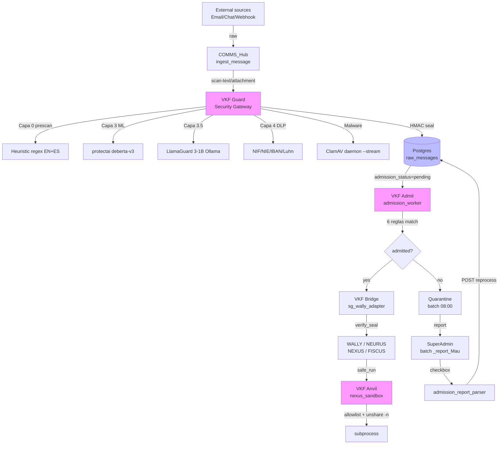

# Threat Model · Vektrun Forge (VKF)

Metodología: **STRIDE** aplicada a la arquitectura VKF v0.1.5.

## Arquitectura de referencia

## STRIDE análisis

### S · Spoofing (identidad falsificada)

| Amenaza | Vector | Mitigación |
|---|---|---|
| Email suplantando notario real | Sender spoofing | R4 (Sender whitelist) requiere contact activo con `linked_to[]` · DKIM/SPF valida en COMMS_Hub upstream |
| Consumer suplanta agente autorizado | Fake HMAC seal | HMAC-SHA256 key en `/etc/security-gateway/hmac.key` chmod 600 · rotate.sh + grace 24h |
| Injection intenta pasar como user legit | XML/prefix injection | Capa 0 detecta `system:`, `<system>`, tokens especiales, dual-LLM pattern recomendado |

### T · Tampering (modificación no autorizada)

| Amenaza | Vector | Mitigación |
|---|---|---|
| Adversario modifica seal en tránsito | MITM | Bind 127.0.0.1:8850 (no público) · HMAC signature verifica payload |
| Attacker modifica `raw_messages` row | SQL injection | Peer auth Postgres sin passwords · psycopg2 param binding · schema con constraints |
| Attacker modifica archivos crypt | File tamper | AGE/SOPS con integridad (MAC) · git tamper-evident |
| Attacker modifica NEXUS scripts | Filesystem | NEXUS sandbox: cwd allowlist · systemd ProtectSystem=strict |

### R · Repudiation (negación de acciones)

| Amenaza | Vector | Mitigación |
|---|---|---|
| Mauri niega haber decidido admit | UI ambigua | `audit_log` con `actor='human:mauri'` · timestamps signed via HMAC · `_report_Mau/*.processed.md` con historial |
| Agente niega ejecutar tool | Sin trace | NEXUS sandbox logs a stdout JSON · systemd journal · SECURITY_LOG.md por SECURITUS |

### I · Information Disclosure (fuga de info)

| Amenaza | Vector | Mitigación |
|---|---|---|
| Body email con NIF filtrado | Log inadvertido | Capa 4 DLP redacta hits antes de audit_log · body cifrable at-rest post-encrypt |
| Secretos en `.env` leaked por script | Bash bug | `pre_bash_secret_guard.py` bloquea cat/diff/head sobre .env · `post_bash_secret_redactor.py` post-hoc |
| Modelo LlamaGuard filtra system prompt | Prompt leak | Ollama local (no OpenAI API) · sin outbound de body a proveedores 3ros |
| Backup con datos claros | Backup leaked | AGE encrypt para `_CONFIDENTIAL/` · Postgres dump requiere DB user auth |

### D · Denial of Service

| Amenaza | Vector | Mitigación |
|---|---|---|
| Consumer runaway satura gateway | Loop error | Rate limit `slowapi` 60/min text · 30/min attach · timeout 30s por scan |
| Attachment enorme consume RAM | Bomb file | cap 100kB texto · file_size sanity check antes de ClamAV |
| Consumidor floodea admission_worker | Bulk pending | LIMIT 200 por batch · timer 15min limita concurrencia |
| LLM infra caída | Ollama down | LlamaGuard fail-open (safe=True + error logged) · gateway sigue con Capa 0+3 |

### E · Elevation of Privilege

| Amenaza | Vector | Mitigación |
|---|---|---|
| Agente intenta rm sistema | Malicious subprocess | NEXUS sandbox verb denylist (rm/dd/mkfs/reboot) · triple confirm P0 |
| Agente accede /etc/shadow | Path traversal | ALLOW_ROOTS: solo /var/www/*, /var/log/*, /tmp, /var/www/vaults · absolute path check |
| Agente escala via unshare | Namespace | unshare -n para deny_network default · user=securitus/coder (no root) |
| Attacker via HTTP endpoint | Public exposure | Bind 127.0.0.1 · systemd hardening (PrivateTmp, ProtectSystem, NoNewPrivileges) |

## Trust boundaries

1. **External → COMMS_Hub** — todo input externo untrusted; ClamAV inline + prescan
2. **COMMS_Hub → raw_messages** — solo securitus user (peer auth)
3. **raw_messages → admitted_messages view** — filter por sealed=1 AND admitted
4. **admitted → agentes** — verify_seal HMAC obligatorio
5. **agentes → subprocess** — NEXUS sandbox safe_run obligatorio

## Assets críticos priorizados

| Asset | Impacto compromise | Nivel |
|---|---|---|
| `hmac.key` | Seals falsificables | CRÍTICO |
| `age.key` (private) | Descifra `_CONFIDENTIAL/` | CRÍTICO |
| Postgres `raw_messages` | Pérdida audit trail + leak PII | ALTO |
| Ollama models | Manipulación clasificación | MEDIO |
| Systemd unit files | Compromiso deploy | MEDIO |

## Roadmap threat model

- [ ] Multi-tenancy → tenant isolation attack analysis (post-MS-A2)
- [ ] External API exposure (si se abre gateway a red) → auth requerida
- [ ] Bypass attempts detection · tabla `blocked_attempts` + alerta >5/hora (Fase 11)
- [ ] Fuzz corpus adversarial (Fase 10) · red team simulation
